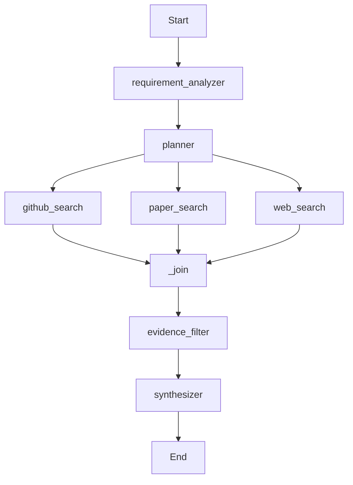

# Research Agent Overview

This document provides a concise description of the **CSE‑focused AI Research Assistant** (the Research Agent) that has been implemented in this repository. It references the actual code files, their responsibilities, and the end‑to‑end workflow from a `ResearchRequest` to a `ResearchResult`.

---

## 1. High‑level Workflow


1. **Requirement Analyzer** – Parses the raw user query and any constraints into a normalized `ResearchRequirement`.
2. **Planner** – Generates concrete search queries for each source type (GitHub, papers, web) while respecting the requirement.
3. **Source Search Nodes** – Query the respective adapters:
   - `github_search` → `research_agent/tools/github_client.py`
   - `paper_search` → `research_agent/tools/paper_client.py`
   - `web_search` → `research_agent/tools/web_search_client.py`
4. **Evidence Filter** – Normalizes results (`source_normalizer.py`), deduplicates, removes irrelevant items, and ranks them (`ranking_service.py`).
5. **Synthesizer** – Calls the LLM (via `services/llm_service.py`) with a JSON‑structured prompt to produce a `ResearchResult` containing:
   - `summary`
   - `key_findings`
   - `recommended_approach`
   - `sources` (traceable URLs and IDs)
   - `limitations`

The graph runs the three searches **in parallel** and joins them, so a failure in one provider does not abort the whole workflow.

---

## 2. Core Files & Their Roles
| Path | Purpose |
|------|---------|
| `research_agent/__init__.py` | Package marker.
| `research_agent/service.py` | Public entry point – `async def run_research(request, context) → ResearchResult`.
| `research_agent/cli.py` | Simple CLI wrapper (`python -m research_agent.cli "<query>"`).
| `research_agent/graph/state.py` | `ResearchState` model (LangGraph state).
| `research_agent/graph/graph.py` | Builds the LangGraph graph and compiles it.
| `research_agent/prompts/requirement_analyzer.py` | System prompt for the requirement‑analysis LLM call.
| `research_agent/prompts/planner.py` | Prompt used by the planner LLM to emit per‑source queries.
| `research_agent/prompts/synthesizer.py` | Prompt for the final synthesis step.
| `research_agent/nodes/requirement_analyzer.py` | Node implementation – calls LLM, parses JSON into `ResearchRequirement`.
| `research_agent/nodes/planner.py` | Calls LLM to create `SourcePlan` (search strings per source).
| `research_agent/nodes/github_search.py` | Calls `github_client.search_repos` with the planner’s query.
| `research_agent/nodes/paper_search.py` | Calls `paper_client.search_papers` (Semantic Scholar).
| `research_agent/nodes/web_search.py` | Calls `web_search_client.search_web` (DuckDuckGo).
| `research_agent/nodes/evidence_filter.py` | Normalizes (`source_normalizer`), dedupes, ranks (`ranking_service`).
| `research_agent/nodes/synthesizer.py` | Calls LLM to produce the final structured research report.
| `research_agent/tools/github_client.py` | Thin wrapper around the GitHub REST API (uses `GITHUB_TOKEN`).
| `research_agent/tools/paper_client.py` | Wrapper for Semantic Scholar API (`SEMANTIC_SCHOLAR_API_KEY`).
| `research_agent/tools/web_search_client.py` | DuckDuckGo web search (no API key required).
| `research_agent/tools/wikipedia_client.py` | Wikipedia API wrapper (used by `web_search`).
| `research_agent/services/llm_service.py` | Async OpenAI‑compatible LLM client (`LLM_API_KEY`).
| `research_agent/services/source_normalizer.py` | Converts raw provider responses into unified `EvidenceItem` objects.
| `research_agent/services/ranking_service.py` | Simple scoring based on recency, stars, citations, etc.
| `shared/schemas/research.py` | Pydantic models for `ResearchRequest`, `ResearchResult`, `EvidenceItem`, etc. (as defined in `TEAM_INTEGRATION_SPEC.md`).
| `shared/enums/__init__.py` | Enums such as `ResearchStatus`.
| `tests/…` | Unit‑ and integration‑tests that mock external APIs.

---

## 3. Input / Output Schemas
```python
# shared/schemas/research.py (excerpt)
class ResearchRequest(BaseModel):
    research_id: str
    query: str
    constraints: Optional[Dict[str, Any]] = None
    source_types: List[Literal["github", "paper", "web"]] = ["github", "paper", "web"]

class EvidenceItem(BaseModel):
    source_id: str  # e.g. "github:repo:123"
    title: str
    url: str
    snippet: Optional[str]
    metadata: Dict[str, Any]

class ResearchResult(BaseModel):
    research_id: str
    status: ResearchStatus
    summary: str
    key_findings: List[str]
    recommended_approach: str
    sources: List[EvidenceItem]
    limitations: List[str]
```
The `run_research` function validates the request against these models and returns a `ResearchResult` that complies with `TEAM_INTEGRATION_SPEC.md`.

---

## 4. How the LLM Is Used
1. **Requirement Analyzer** – Generates a JSON object describing the parsed requirement.
2. **Planner** – Emits a `SourcePlan` JSON with separate query strings for each enabled source.
3. **Synthesizer** – Receives the filtered evidence list and produces the final report, also as JSON.
All calls use the `LLMService` wrapper (`services/llm_service.py`) which talks to an OpenAI‑compatible endpoint (`LLM_API_KEY`). The prompts enforce a strict JSON output schema to avoid hallucinations.

---

## 5. Error & Failure Handling
* Each source node catches exceptions from its adapter. On failure it logs the issue and returns an empty list, allowing the rest of the graph to continue.
* The evidence filter records any provider failures in the `limitations` field of the final `ResearchResult`.
* If the LLM returns malformed JSON, the node raises a `ResearchException` which is caught by the graph runner and translated into a `ResearchResult` with `status=FAILED`.
* Environment‑variable missing errors are surfaced as clear messages (e.g., "LLM_API_KEY not set").

---

## 6. Required Environment Variables
| Variable | Purpose |
|----------|---------|
| `LLM_API_KEY` | OpenAI‑compatible LLM access (required for any run).
| `GITHUB_TOKEN` *(optional)* | Authenticated GitHub API calls – higher rate limits.
| `SEMANTIC_SCHOLAR_API_KEY` *(optional)* | Access to Semantic Scholar API for paper search.
| `WIKIPEDIA_USER_AGENT` *(optional)* | Custom User‑Agent header for Wikipedia requests.

The `.env.example` file at the repository root lists these keys.

---

## 7. Integration Points
* **Team Integration** – The only public contract is the `run_research` function in `research_agent/service.py`. The backend can import this module and call the function, passing a validated `ResearchRequest`.
* **Standalone Use** – The CLI (`python -m research_agent.cli "<query>"`) and the FastAPI endpoint (`/api/v1/research`) both delegate to `run_research`, so the agent works out‑of‑the‑box.
* **Future Extension** – Provider adapters are isolated under `research_agent/tools/`. Replacing a provider (e.g., switching from Semantic Scholar to Crossref) requires only updating the corresponding client without touching the graph or service layer.

---

## 8. Running & Testing
```bash
# Install dependencies
pip install -r requirements.txt

# Set environment variables (example)
export LLM_API_KEY=sk-...   # Windows: set LLM_API_KEY=...
export GITHUB_TOKEN=ghp_...
export SEMANTIC_SCHOLAR_API_KEY=...

# Run unit tests (all external calls are mocked)
pytest -q

# Run a live query (requires real keys)
python -m research_agent.cli "Compare LangGraph and CrewAI for building a multi‑agent coding assistant"
```

---

## 9. Quick Architectural Summary
* **LangGraph** orchestrates the pipeline, handling parallel searches and graceful degradation.
* **Adapters** encapsulate external API logic, keeping the graph agnostic of HTTP details.
* **Normalizer + Ranking** produce a clean, ordered list of evidence items.
* **LLM** is the only component that performs natural‑language reasoning (analysis, planning, synthesis).
* **Public Service** (`run_research`) offers a language‑agnostic, contract‑driven entry point compatible with the team’s `TEAM_INTEGRATION_SPEC.md`.

---

*This README is generated from the actual codebase and reflects the current implementation. No hidden or speculative components are described.*
