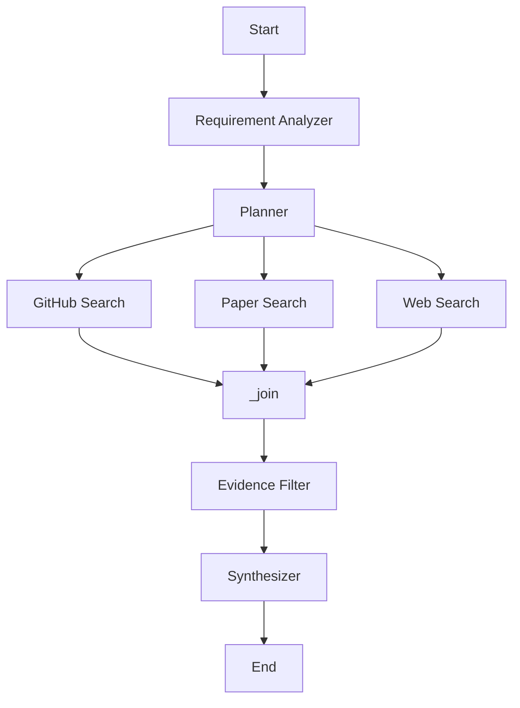

# Research Agent Workflow & Flowchart

This document captures the **end‑to‑end workflow** of the CSE‑focused AI Research Assistant (the Research Agent) and provides a visual **flowchart** with detailed explanations for each node.

---

## 1. High‑level Flowchart


*The graph runs the three source searches **in parallel** after the planner step and then joins the results before filtering and synthesis.*

---

## 2. Step‑by‑Step Explanation

| Step | Module / File | What It Does | Key Outputs |
|------|---------------|--------------|-------------|
| **Start** | – | Entry point – a `ResearchRequest` arrives via the public `run_research()` function (`service.py`). | – |
| **Requirement Analyzer** | `research_agent/nodes/requirement_analyzer.py` | Calls the LLM using the prompt in `research_agent/prompts/requirement_analyzer.py`. It parses the raw user query (and any constraints) into a structured `ResearchRequirement` model. | `ResearchRequirement` (includes normalized query, desired source types, any filters). |
| **Planner** | `research_agent/nodes/planner.py` | Feeds the `ResearchRequirement` to the LLM (prompt `planner.py`). The LLM generates a `SourcePlan` – a separate search string for each enabled source (`github_query`, `paper_query`, `web_query`). | `SourcePlan` with up‑to‑three queries. |
| **GitHub Search** | `research_agent/nodes/github_search.py` → `research_agent/tools/github_client.py` | Executes `github_client.search_repos(github_query)`. Uses `GITHUB_TOKEN` when present, handles rate‑limit errors, returns a list of repository metadata objects. | List of raw GitHub repo dicts. |
| **Paper Search** | `research_agent/nodes/paper_search.py` → `research_agent/tools/paper_client.py` | Calls Semantic Scholar (`paper_client.search_papers(paper_query)`). Returns paper metadata (title, authors, abstract, citation count, URL). | List of raw paper dicts. |
| **Web Search** | `research_agent/nodes/web_search.py` → `research_agent/tools/web_search_client.py` (DuckDuckGo) → optional Wikipedia client. | Performs a web search for the `web_query`. Returns a collection of result items (title, URL, snippet). | List of raw web result dicts. |
| **_join** | Internal LangGraph node (`_join`) | Merges the three parallel streams into a single list of evidence items. No transformation; just synchronises the flow. | Combined list of raw evidence from all sources. |
| **Evidence Filter** | `research_agent/nodes/evidence_filter.py` | * Normalization – `source_normalizer.normalize()` converts each raw item into a unified `EvidenceItem` model.
* Deduplication – removes items with identical URLs or source IDs.
* Relevance filtering – discards items that do not match the original requirement (simple keyword check).
* Ranking – `ranking_service.rank(evidence_list)` scores items using stars, stars, citations, recency, etc., and orders them descending.
| Filtered, ranked `EvidenceItem` list and a list of any *limitations* (e.g., provider failures). |
| **Synthesizer** | `research_agent/nodes/synthesizer.py` → `services/llm_service.py` (prompt `synthesizer.py`) | Sends the filtered evidence and the original requirement to the LLM. The LLM must output a JSON `ResearchResult` containing:
- `summary`
- `key_findings`
- `recommended_approach`
- `sources` (list of the evidence items with citations)
- `limitations`
| Final `ResearchResult` object. |
| **End** | `research_agent/service.py` (`run_research`) | Returns the `ResearchResult` to the caller (CLI, FastAPI endpoint, or other service). | JSON‑serialisable response complying with `TEAM_INTEGRATION_SPEC.md`. |

---

## 3. Provider Details
- **GitHub** – REST API (`https://api.github.com/search/repositories`). Auth via `GITHUB_TOKEN` for higher rate limits. Only metadata is collected; repositories are **not cloned**.
- **Papers** – Semantic Scholar API (`https://api.semanticscholar.org/graph/v1/paper/search`). Optional `SEMANTIC_SCHOLAR_API_KEY`.
- **Web** – DuckDuckGo Instant Answer API (`https://api.duckduckgo.com`). If a result points to a Wikipedia page, the `wikipedia_client` fetches a short excerpt for richer context.

All adapters return plain dictionaries; the `source_normalizer` unifies them into `EvidenceItem` defined in `shared/schemas/research.py`.

---

## 4. Error & Failure Handling
1. **Adapter errors** – each search node catches exceptions; on failure it returns an empty list and logs the incident. The `Evidence Filter` records a human‑readable message in the `limitations` field of the final result.
2. **LLM malformed output** – the node validates JSON; on failure it raises `ResearchException` which is caught by the workflow runner and surfaces as `status: FAILED` with an explanatory limitation.
3. **Missing environment variables** – the LLM service checks for `LLM_API_KEY` at startup and raises a clear error if absent.
4. **Graceful degradation** – even if one or two providers fail, the remaining successful results are still synthesized, ensuring the agent never completely crashes.

---

## 5. Where the LLM Is Used
- **Requirement Analyzer** – extracts intent, constraints, and desired source types.
- **Planner** – decides concrete search queries per source.
- **Synthesizer** – composes the final research report, citing evidence items.
All three calls enforce a strict JSON schema in the prompts to minimise hallucinations.

---

## 6. Integration Point
The **only public API** is the function in `research_agent/service.py`:
```python
async def run_research(request: ResearchRequest, context: ServiceContext) -> ResearchResult:
    """Execute the full LangGraph workflow and return a validated result."""
```
Both the FastAPI endpoint (`/api/v1/research`) and the CLI (`research_agent/cli.py`) delegate to this function, guaranteeing a consistent contract for the larger platform.

---

## 7. Quick Run Commands
```bash
# Install dependencies
pip install -r requirements.txt

# Set required env vars (Windows syntax shown)
set LLM_API_KEY=your_key
set GITHUB_TOKEN=your_token   # optional but recommended
set SEMANTIC_SCHOLAR_API_KEY=your_key   # optional

# Run a live query (requires the keys above)
python -m research_agent.cli "Compare LangGraph and CrewAI for building a multi‑agent coding assistant"
```
The CLI prints the `ResearchResult` JSON.

---

*This document (WORKFLOW.md) serves as the definitive reference for the Research Agent’s internal flow and can be shared with other team members for integration or maintenance.*
